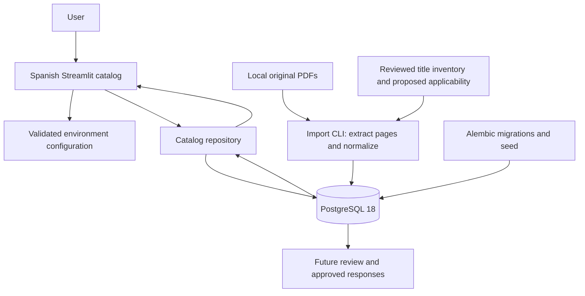
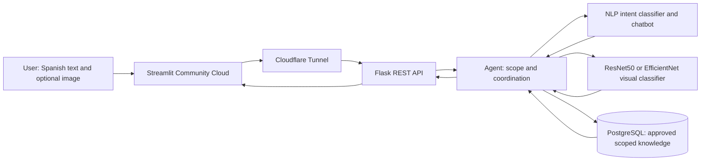
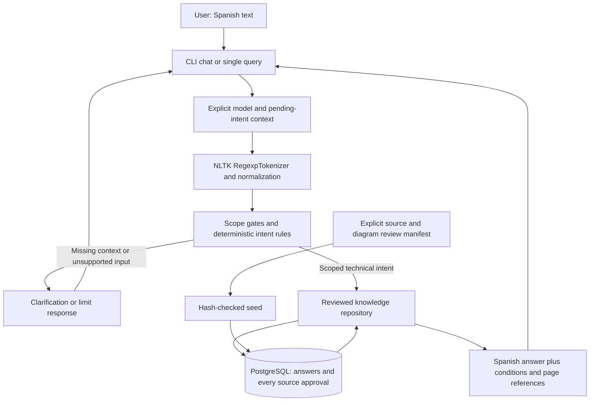
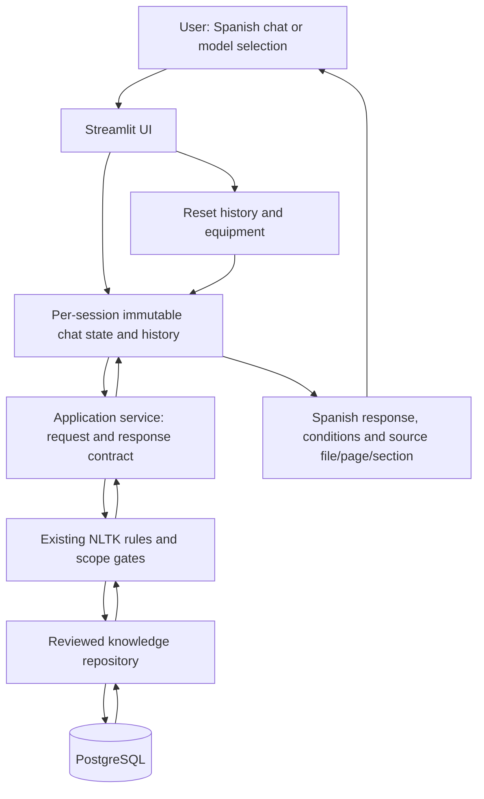
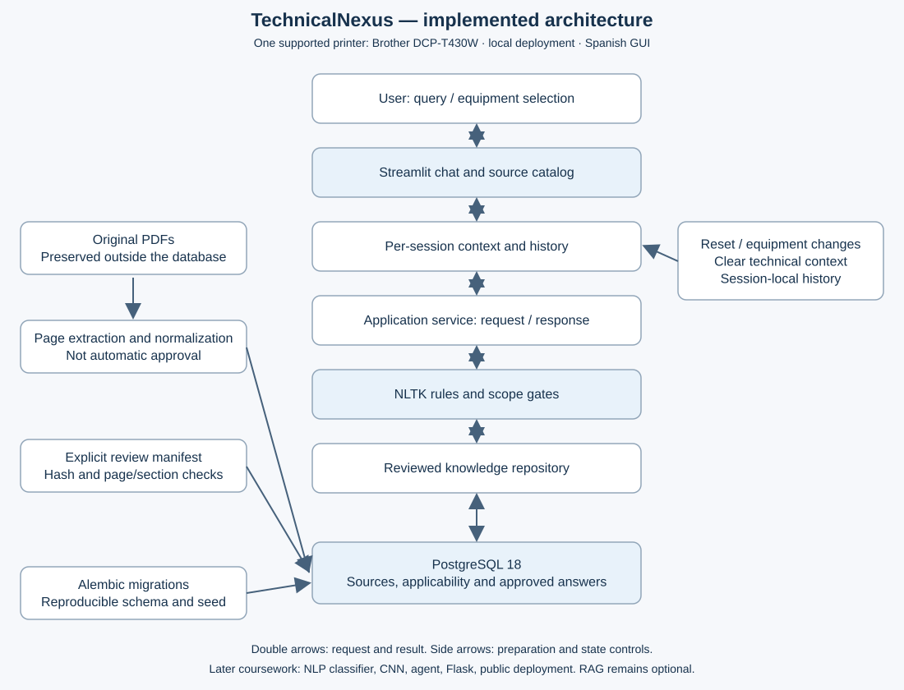

# TechnicalNexus — living academic draft

**Status:** phase-4 review draft, 2026-10-17. Not the completed Advance 1 or final report.
This file accumulates architecture, decisions and evidence for the eventual
15–20-page final document. Phase 2 adds bounded rules-based maintenance answers. This does not claim trained-model performance, repair success or benefits measured with users.

## Problem, users and objective

Office printer users and maintenance personnel must locate instructions across
manuals, software guides and regional supplements. Applying a procedure to the
wrong model or treating a generic feature description as device support can
produce misleading guidance. The need is traceable assistance constrained to
authorized equipment, sources and procedures.

Advance 1 aims to implement and validate a rules-based assistant for approved
maintenance queries. Brother DCP-T430W is the first selected model; two other
brands/models will be selected by the student. Reuse across equipment is achieved
through explicit catalog/applicability and knowledge records, not unrestricted
answers. Expected benefits are easier source lookup and clearer scope; time and
error reductions remain hypotheses, not observed results.

The final objective is an integrated web assistant using NLP, an image classifier
and a coordinating agent, guiding the same maintenance task with documented
limits. Images may identify visible print categories; they must not be treated as
proof of root cause or printer identity without separate validation.

## Phase 1 implemented architecture

The repository is a data-access boundary, not a GitHub repository in this diagram.
Streamlit runs locally in Python and presents results in a browser. PostgreSQL is
a separate local process. PDF text is stored by document hash and physical page;
raw and normalized text are distinct. Originals remain unchanged. Import alone leaves applicability and page approval pending. Phase 2 explicitly reviews selected source sections for seven scoped answers; extraction success still never grants approval by itself.

The initial reference page was rendered and inspected: it contains multiple
languages, model groups and columns. Plain extraction is therefore not a faithful
replacement for the layout. Section-level review and language separation are
needed before composing Spanish answers. Three empty-text pages and one page
with replacement characters were flagged during import; OCR is not implemented.

No separate backend API, LLM, image model, vector index or trained intent model
exists yet. The engine now implements the phase-1 request/context/response contract using NLTK tokenization and deterministic rules. It asks for missing models, resumes one pending intent, returns referenced knowledge and handles tested scope/ambiguity cases. State is explicit per caller. Tests cover free-text examples without claiming universal semantic rejection.

## Target architecture for the final project (not implemented)

The tunnel communicates with a continuously available backend; PostgreSQL also
needs persistent hosting. No provider for these two runtime responsibilities is
chosen yet. Adding embeddings later is optional and does not replace the required
text or CNN classifiers. The image class must contribute to the conversational
case, rather than appear in a disconnected demonstration.

## Development stages and current evidence

1. Foundation: pinned Python/uv dependencies, PostgreSQL schema and migration,
   PDF inventory/import, interface catalog, explicit contract and initial tests.
2. Rules engine and reviewed knowledge: implemented for Brother; seven reviewed responses, source-restricted PostgreSQL access and a CLI demonstration. Phase 2 owner validation is accepted; two equipment models remain pending.
3. Streamlit conversations: implemented for Brother; shared rules engine, explicit per-session state, selector/history/reset, references and controlled errors. Owner validation accepted; all three phase-3 checks were reported successful.
4. Advance-1 validation/package: prepared for Brother; 17 independent GUI conversations, 40 turns, reproducible fresh-schema source import, clean-environment tests and review materials. Package owner acceptance and two further printer models remain pending.

See `docs/phase1-evidence.md` for executed checks and `docs/user-validation.md`
for the recorded owner acceptance and observed manual checks.

## Rubric traceability and continuation

| Requirement | Evidence / status |
|---|---|
| Problem, users, need, objective, scope and benefits | Foundation objective and architecture reviewed by owner |
| Architecture and component exchanges | Implemented and target diagrams above |
| All intent entry → identification → response flows | docs/intents-and-flows.md |
| Python 3.10+ and functional NLTK rules chatbot | Python 3.12.14; NLTK RegexpTokenizer and rules engine, available through CLI |
| GitHub | Phase-1 source versioned in private repository; phase-2 commit recorded in Git history |
| Ten conversations and analysis | 17 independent AppTest GUI conversations, 40 turns; docs/advance1-validation.md and analysis below; single-model scope |

Advance 2 (week 5): tokenization, normalization, stopwords, stemming/lemmatization;
TF-IDF or BoW; Naive Bayes or SVM; CNN transfer learning with ResNet50 or EfficientNet;
accuracy, precision, recall, F1 and confusion matrix; integrated text/image result.
Final (week 8): Streamlit + Flask, chatbot NLP + visual classifier + coordinating
agent, public URL, errors/monitoring, integrated testing and performance/scalability/
maintainability/ethics analysis. Final deliverables include 15–20 pages, GitHub,
5–10-minute demo, public URL, architecture, testing/deployment evidence, model/chatbot
metrics and future improvements. Week 8 is reserved for integration/review/correction.

Course pages previously inspected in the authenticated browser:
- https://cursos.tecmilenio.mx/courses/254360/assignments/4614153
- https://cursos.tecmilenio.mx/courses/254360/assignments/4614156
- https://cursos.tecmilenio.mx/courses/254360/assignments/4614163

Colab appeared in the originally read rubric; the student subsequently clarified
it is optional and explicitly chose local development. This is a recorded student
instruction, not a claim that the published page was amended.

## Risks and ethics

Do not transfer procedures across models, infer unsupported network capabilities,
turn image classes into diagnoses, or approve text automatically after extraction.
Protect source provenance and private documents; permissions to redistribute
manuals and future datasets remain to be reviewed. Do not log personal image
content or publish credentials. Synthetic image transformations must not leak
between training and test partitions. No inference or user-success metrics exist
yet, and no production isolation/security guarantee has been evaluated.

## Phase 2 implemented architecture and analysis

The CLI was the phase-2 demonstration interface. Phase 3 now connects Streamlit to the same engine rather than create a second implementation. Technical answers require exact instance, equipment, intent and
language, a reviewed answer, confirmed document applicability and all source pages
approved for the linked reviewed sections. The JSON review manifest is an import
record; inference does not consult it as a fallback when PostgreSQL is unavailable.

Reference-guide pages 1–4 were read and rendered for visual checks. Normal head
cleaning includes button relationships visible in the diagram, not reconstructed
from interleaved multilingual extraction. The jam answer directs users to the
diagrams rather than inventing a complete disassembly sequence. Approval notes
identify agent source review, not human/manufacturer certification. Other manuals
and procedures are not authorized by association with this equipment folder.

Observed tests found “normal” matching an overbroad “norma” rule; the rule was
corrected and covered by regression. Quality matching now requires printing or
head-cleaning context. Five actual PostgreSQL-backed multi-turn CLI conversations
are in docs/phase2-demo.json. Full test results and limits are in
docs/phase2-evidence.md. No trained-classifier metrics are available yet.

Main limitation: phrase rules and a finite unrelated-domain vocabulary do not
understand arbitrary paraphrases, mixed topics or negation. Missing/unrecognized
wording may require reformulation, and untested cases can still be misclassified.
Improve using observed regression failures and the required Advance-2 intent
dataset/classifier while preserving the repository's independent source gates.
Owner accepted this phase and supplied a successful CLI transcript; see docs/phase2-owner-validation.md. At phase-2 acceptance, final GUI evaluation was pending; phase 4 now records 17 independent GUI conversations below.

## Phase 3 implemented web integration

The GUI maintains no separate inference rules. Each query uses explicit model and
pending-intent context. Selecting an equipment answers a pending model question;
reset and unknown-model rejection discard technical context. The selector reflects
model changes typed in chat. A normal rerun retains messages without submitting
the last question twice. Histories are not persisted in PostgreSQL and are separate
per Streamlit session; authentication/multi-tenant isolation remains unimplemented.

Data-access failures produce a Spanish controlled error, keep history/model and
allow retry after recovery. Tests simulate the failure without stopping development
PostgreSQL. Synthetic reviewed records in isolated test schemas keep GUI tests
independent of private manual files. Owner validation is a separate three-step check,
recorded in docs/user-validation.md. Phase 4 now supplies the recorded 17-conversation evaluation below.

## Phase 4 — implemented-scope evaluation and review material

### Why an intelligent assistant is appropriate

Users describe problems with different wording and may omit the model or mix
procedures. The problem calls for managing conversational context and selecting
applicable technical knowledge, with a later role for interpreting visual evidence.
Advance 1 uses a controlled symbolic baseline: NLTK tokenization, explicit intent
rules and reviewed responses. It does not learn from manuals or infer repairs.
Subsequent trained NLP and CNN components address broader language/visual variation
while retaining independent source/applicability checks. This justifies the AI
project direction without calling the current rules engine a trained model.

### Architecture artifact

Editable Mermaid source: docs/architecture/current.mmd. The diagram shows actual
user, chatbot, knowledge base and flow relationships; the earlier final target
diagram remains future work, including Flask, CNN, agent and public hosting.

### Method and results

Seventeen conversation cases with expected results were written before execution.
Each starts an independent Streamlit AppTest session against a fresh PostgreSQL
schema reconstructed from migrations, the original supplied PDFs and reviewed
knowledge. The validation imported 10 documents/169 pages and 7 reviewed answers.
All 17 conversations and all 40 turns passed the predefined intent, status, active
equipment, physical source-page and visible-reference checks. Full actual inputs
and replies appear in docs/advance1-validation.md and docs/advance1-conversations.json.

A separately reconstructed Python 3.12.14 environment using uv.lock passed the
66 accumulated tests. Integration tests and evaluation use PostgreSQL, not SQLite.
The generated validation schema was removed after execution; development data was
not cleaned. This documents reproducibility of setup and the tested behavior, not
production portability, universal language understanding or successful physical
repairs. Source manifest/code hashes and run metadata identify the evaluated state.

### Observed functioning, limitation and related improvement

The assistant requested missing equipment and resumed the topic after selection.
It answered reviewed ink/paper/normal-cleaning topics with source pages, pointed to
jam diagrams instead of inventing steps, refused unsupported norms and HR queries,
cleared context for an unapproved printer, and recovered after a simulated DB failure.
The measured failure turn took 9042.73 ms, while the other 39 AppTest turns averaged
140.11 ms (range 101.2–276.4 ms). These are UI/framework test durations, not isolated
inference latency or real-network production measurements. Multiple catalog/answer
connection attempts during reruns are a plausible contributor to the slow failure
path; reducing repeated checks and reviewing timeouts is a concrete next improvement
to validate with the same case. An unavailable database must still never trigger
an invented technical answer.

Only one model is currently available. Unknown-model rejection and session reset
are tested, but switching between two admitted printers is not. Incorporate the
other two models and reviewed sources, then extend those cases before declaring
the planned three-model scope complete. Finite phrase rules remain limited even
though these fixed cases pass; the later intent dataset needs independent evaluation,
not reuse of this functional pass rate as classifier accuracy. A complete improvement
plan is in docs/improvement-plan.md.

### Submission boundary

The evidence package and rubric map are in docs/advance1-review-package.md. Phases
1–3 are owner accepted; phase-4 package review is pending. The student must confirm
instructor access to the private repository or an allowed code export and personally
review/submit in Canvas. Colab's original published mention and the student's later
local-only clarification remain explicitly distinguished. This Markdown draft is
material for the final technical document, not a claim that its 15–20 pages, video,
public URL or trained-model metrics have already been produced.
