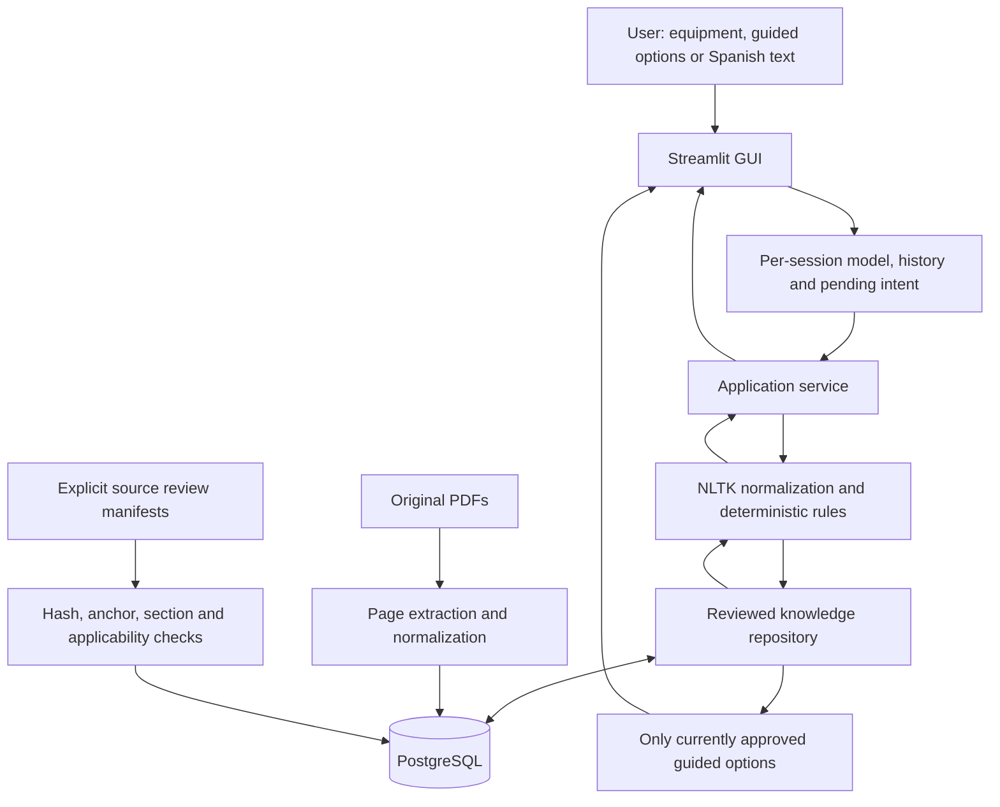
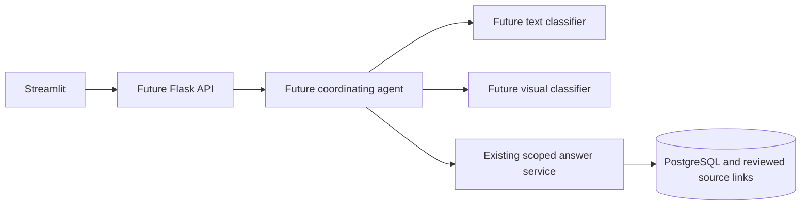

# TechnicalNexus — living academic draft

**Status: 2026-10-22, three-model implementation draft.** This is source material
for the Advance-1 deliverable and eventual final report, not the finished academic
submission. The owner accepted earlier phases for T430W; new-model and package
acceptance remain pending. No physical repair outcomes or measured user benefits
are asserted.

## Problem, users and objective

Office users and maintenance personnel must find instructions in long manuals
that cover several models, optional accessories and regions. Similar symptom
names can lead to applying another printer's procedure. TechnicalNexus aims to
make reviewed instructions easier to find while retaining the exact equipment,
source version, page and conditions of each response.

The first domain is office-printer maintenance. Users are office support staff,
operators and technicians seeking documented user-level orientation. Expected
benefits include easier retrieval and fewer model-selection mistakes; these are
hypotheses until evaluated with users, not measured results.

The selected models are Brother DCP-T430W, Brother DCP-T220 and Canon imageRUNNER
ADVANCE DX C3935i. Two Brother printers share the brand and ink-tank approach;
Canon adds a different product family. Three different brands were an early
diversity preference, not a rubric requirement. Scope is determined per model,
not inferred from the brand or a shared manual.

## Why a rules-based assistant at this stage

Advance 1 implements a symbolic conversational baseline in Python with meaningful
NLTK RegexpTokenizer normalization, explicit intent rules and clarification flows.
It does not train a language model, infer repairs or generate unsourced content.
Negation is preserved. The finite rules handle tested wording; they do not prove
universal semantic understanding or guarantee isolation against every paraphrase.

Guided navigation improves usability with that finite vocabulary. After choosing
an equipment, the user selects a topic and specific question. The menu is filtered
through the same live approval/source repository as answers. It submits canonical
Spanish text to the same NLTK/rules service; it is not a separate answer engine.
Free text remains available for intent identification, clarification and scope
rejection. Missing evidence returns a controlled refusal.

## Architecture and data exchanges

The block diagram is also available as docs/architecture/current.svg and editable
Mermaid. Streamlit is both the current GUI and local adapter. A reusable service
opens a short-lived database session and calls the engine. PostgreSQL stores
instances, equipment, source metadata/pages, intents, reviewed answers and source
relationships. PDF originals stay external, identified by SHA-256 and paths.
No SQLite migration, vector search or API is required for this milestone.

The GUI keeps each session's history and pending intent in Streamlit session state;
these are not stored in PostgreSQL. Browser session separation is not production
authentication or tenant authorization. Each supported-model switch clears the old
history, pending context and guided choices. Unknown/mixed models clear the active
equipment. The source catalog is filtered by the selected printer.

## Current reviewed knowledge and applicability

| Model | Reviewed answers | Initial scope |
|---|---:|---|
| Brother DCP-T430W | 7 | Visible ink level, post-refill action, confirmed no-paper, tray insertion, normal head cleaning, jam diagrams and manual location |
| Brother DCP-T220 | 8 | Its own versions of those seven topics, plus scanner-glass cleaning |
| Canon C3935i | 4 | Toner-level display, copy-glass cleaning, general jam precautions and manual location |

The T220 refill response uses Detener only if the ink LED flashes; it does not
borrow the T430W Papel + Atajo Copia combination. For a T220 jam, the documented
inside-equipment procedure begins by unplugging. Canon's general jam precautions
say not to power off while clearing the jam. This illustrates why matching a
symptom without preserving equipment identity is insufficient.

Canon's Spanish PDF is European edition USRMA-8188-03 (2025-09). The enabled toner,
glass-cleaning and jam sections were cross-checked against official Latin America
USRMA-8189-03. Physical PDF pages remain the citation anchors. This limited review
does not authorize regional regulation, electrical specifications, accessory or
other chapters. The exact online cross-check URLs and PDF hashes are recorded in
`data/knowledge/canon_c3935i.json` and docs/model-expansion.md.

Import registered 19 document/equipment associations, represented by 16 unique
PDF hashes and 2,197 extracted pages. Identical software files are stored once;
their applicability remains a separate relationship for each model. Import and
classification do not automatically approve technical content. Only the linked
reviewed sections support the 19 answers. Source review is an agent-assisted
technical review with owner acceptance pending, not manufacturer certification.
Original licensed documents remain local and outside Git.

## Intent identification and conversation behavior

The technical intentions are ink_level, after_refill, no_paper, tray_not_detected,
print_quality, paper_jam, manual_location, toner_level and glass_cleaning. Not every
intention has an approved answer on every printer. Canon ink/head cleaning and
Brother toner queries remain without evidence; the engine never substitutes
another model's answer. See docs/intents-and-flows.md for exact flow definitions.

Control flows include greeting, help, model selection, clarification, reset,
closure, unsupported equipment/language, unrelated department, unavailable norms,
excluded repairs and database errors. A query naming two supported printers or a
contradictory brand/model is rejected rather than merged. A missing model can
remember one technical intent and resume it after explicit selection.

A response is available only when the exact instance, equipment, intention and
language match an approved answer with a review note. Every source page must be
approved, successfully extracted, associated with confirmed model applicability
and have a section reference. Missing or revoked evidence fails closed. The menu
uses those same gates, and submitting an option rechecks them. No runtime JSON or
other-model answer fallback is used when PostgreSQL is unavailable.

## Development phases and reproducibility

1. Foundation: locked Python environment, PostgreSQL/Alembic schema, conservative
   PDF extraction, initial source inventory and Spanish catalog. Owner accepted.
2. Rules engine: reviewed T430W responses, CLI, intent precedence and scope tests.
   Owner supplied successful CLI evidence; see phase2-owner-validation.md.
3. Streamlit chat: per-session state, model selection, reset, citations and error
   handling. Owner reported the three original GUI checks successful. Guided
   navigation and the original user illustration on a blue background were added.
4. Validation and three-model integration: added exact model aliases, sources,
   scoped answer manifests, menu filtering and supported-model switching tests.
   Automated validation is complete for the predefined cases; owner checks pending.

Python 3.12.14 and the existing uv.lock are retained. There are no new packages or
schema migrations for adding the models. README describes setup, local PostgreSQL,
import, reviewed-knowledge seeding and execution. The private repository is
https://github.com/Praxisinfinitum/TechnicalNexus. Instructor access has not yet been
proven. The originally inspected rubric mentioned Colab; the owner clarified it
was optional and chose local Streamlit development with GitHub versioning.

## Validation results and practical limits

The predefined evaluation contains **38 independent conversations / 97 turns**
executed with Streamlit AppTest against a freshly migrated, isolated PostgreSQL
schema containing the actual original PDFs and reviewed answers. All predefined
status, intent, active-model, source-page, model-specific text and visible-reference
checks passed. The generated schema was removed afterwards; development data was
not cleaned. See docs/advance1-validation.md and advance1-conversations.json for
actual inputs, outputs, versions, original hashes and code/input fingerprint.

The expanded code suite passed **97 unit, regression, PostgreSQL integration and
UI tests**. These cover model-switch state, exact repository scope, source
revocation, guided/text equivalence and unsupported model/procedure inputs. The
earlier 66-test clean-environment reconstruction is historical; the expanded suite
was run in the existing locked development environment.

The fixed functional pass rate is not classifier accuracy, proof of arbitrary
language safety, successful physical repair or production scalability. The
unavailable-database scenario still takes about nine seconds; repeated requests
and connection timeouts are an improvement target. UI timings include framework
and database work. PDF layout still needs visual review. Additional procedures,
regions and aliases require explicit source review and independent regression.

Three short owner checks are in docs/user-validation.md. Physical maintenance is
not required to validate this interface. User acceptance, academic-document
assembly, instructor access and Canvas submission remain pending.

## Rubric traceability for Advance 1

| Criterion | Points | Evidence |
|---|---:|---|
| Problem and justification | 20 | Problem, objective, users, scope and expected benefits above |
| Conceptual architecture | 20 | Current block/flow diagrams and component/data explanation |
| Intents and conversation flows | 20 | Nine technical intentions, control flows, guided/text routing and limits |
| Python/NLTK rules implementation | 25 | Shared engine, PostgreSQL gates, local Streamlit and GitHub code |
| At least ten conversations and analysis | 15 | 38 real-source GUI conversations, 97 turns, tests and improvement analysis |

The recorded rubric does not specify an Advance-1 minimum page count or require
three printer brands. The facilitator separately requested the architecture block
diagram. The student reviews, understands and submits the work personally.

## Alignment with Advance 2 and final project

Advance 2 will add a properly separated text dataset, normalization, stopwords,
stemming/lemmatization, TF-IDF/BoW and NB/SVM evaluation, plus ResNet50/EfficientNet
transfer learning with accuracy, precision, recall, F1 and confusion matrix. No
suitable visual dataset has yet been selected. Printer images/classes must have
provenance and split rules; manual diagrams are not independent training photos.

The final target adds a coordinating reactive/deliberative/hybrid agent and Flask
REST API used by Streamlit. Text/image predictions contribute to the selected
printer's case; the existing source/applicability gates remain independent.
Streamlit Community Cloud plus Cloudflare Tunnel are the selected later delivery
path; persistent Flask/PostgreSQL hosting is still required because a tunnel is
not a host. No public deployment, trained classifier or CNN is claimed today.

The final 15–20-page technical report, 5–10-minute video, public URL, integrated
metrics and deployment evidence belong to later coursework. This living Markdown
note will supply material for those documents; it is not their completed version.

## Source and evidence references

- README.md: setup and app operation.
- docs/model-expansion.md: reviewed new-model scope and regional checks.
- docs/source-inventory.md: imported document identities and source links.
- data/document_manifest.json and data/knowledge/: reproducible metadata/review.
- docs/advance1-validation.md: executed conversation evidence.
- docs/advance1-review-package.md: rubric map and delivery boundaries.
- docs/improvement-plan.md: limitations and later coursework.
