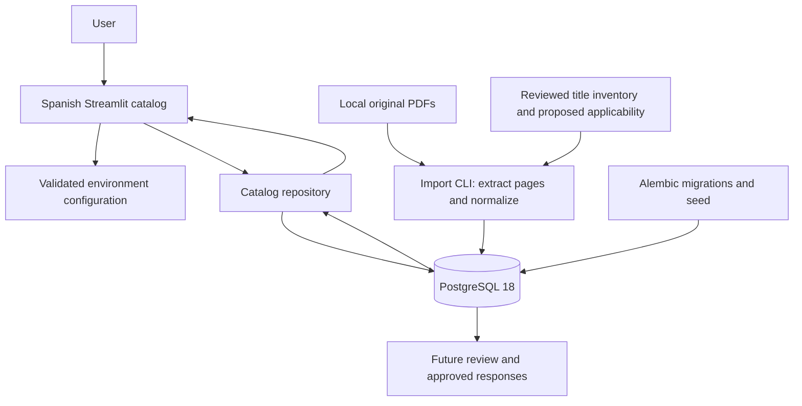
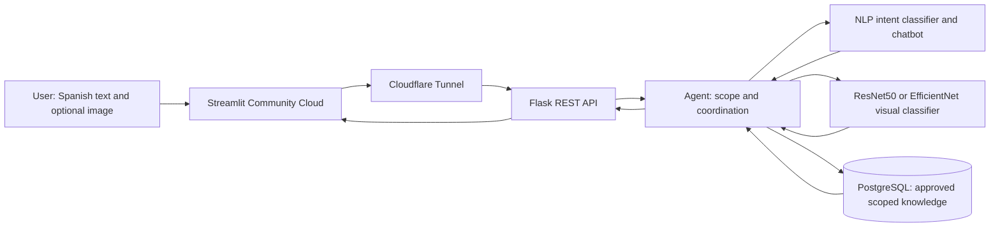

# TechnicalNexus — living academic draft

**Status:** phase-1 draft, 2026-10-17. Not the completed Advance 1 or final report.
This file accumulates architecture, decisions and evidence for the eventual
15–20-page final document. Findings below do not claim functional maintenance
answers, learning performance or benefits measured with users.

## Problem, users and objective

Office printer users and maintenance personnel must locate instructions across
manuals, software guides and regional supplements. Applying a procedure to the
wrong model or treating a generic feature description as device support can
produce misleading guidance. The need is traceable assistance constrained to
authorized equipment, sources and procedures.

Advance 1 aims to implement and validate a rules-based assistant for approved
maintenance queries. Brother DCP-T430W is the first selected model; two other
brands/models will be selected by the student. Reuse across equipment is achieved
through explicit catalog/applicability and knowledge records, not unrestricted
answers. Expected benefits are easier source lookup and clearer scope; time and
error reductions remain hypotheses, not observed results.

The final objective is an integrated web assistant using NLP, an image classifier
and a coordinating agent, guiding the same maintenance task with documented
limits. Images may identify visible print categories; they must not be treated as
proof of root cause or printer identity without separate validation.

## Phase 1 implemented architecture

The repository is a data-access boundary, not a GitHub repository in this diagram.
Streamlit runs locally in Python and presents results in a browser. PostgreSQL is
a separate local process. PDF text is stored by document hash and physical page;
raw and normalized text are distinct. Originals remain unchanged. Applicability
and page approval remain pending, even when extraction succeeds.

The initial reference page was rendered and inspected: it contains multiple
languages, model groups and columns. Plain extraction is therefore not a faithful
replacement for the layout. Section-level review and language separation are
needed before composing Spanish answers. Three empty-text pages and one page
with replacement characters were flagged during import; OCR is not implemented.

No separate backend API, LLM, image model, vector index or trained intent model
exists yet. The phase-1 engine contract defines request/context and response states;
its rules-based conversation implementation belongs to phase 2. State must be
explicit per session; scope selection tests do not demonstrate free-text rejection.

## Target architecture for the final project (not implemented)

The tunnel communicates with a continuously available backend; PostgreSQL also
needs persistent hosting. No provider for these two runtime responsibilities is
chosen yet. Adding embeddings later is optional and does not replace the required
text or CNN classifiers. The image class must contribute to the conversational
case, rather than appear in a disconnected demonstration.

## Development stages and current evidence

1. Foundation: pinned Python/uv dependencies, PostgreSQL schema and migration,
   PDF inventory/import, interface catalog, explicit contract and initial tests.
2. Rules engine and approved knowledge: pending; implement NLTK-based processing,
   intents, exact equipment applicability and source-backed responses.
3. Streamlit conversations: pending; connect the engine, state, references and errors.
4. Advance-1 validation/package: pending; ten or more distinct conversations,
   limitations, improvements and reviewed GitHub materials.

See `docs/phase1-evidence.md` for executed checks and `docs/user-validation.md`
for owner acceptance, which remains pending until explicitly reported.

## Rubric traceability and continuation

| Requirement | Evidence / status |
|---|---|
| Problem, users, need, objective, scope and benefits | This draft; owner review pending |
| Architecture and component exchanges | Implemented and target diagrams above |
| All intent entry → identification → response flows | Pending phase 2 |
| Python 3.10+ and functional NLTK rules chatbot | Python 3.12.14 ready; NLTK installed, engine pending |
| GitHub | Private repository created; code publication not claimed by this document |
| Ten conversations and analysis | Pending phase 4 |

Advance 2 (week 5): tokenization, normalization, stopwords, stemming/lemmatization;
TF-IDF or BoW; Naive Bayes or SVM; CNN transfer learning with ResNet50 or EfficientNet;
accuracy, precision, recall, F1 and confusion matrix; integrated text/image result.
Final (week 8): Streamlit + Flask, chatbot NLP + visual classifier + coordinating
agent, public URL, errors/monitoring, integrated testing and performance/scalability/
maintainability/ethics analysis. Final deliverables include 15–20 pages, GitHub,
5–10-minute demo, public URL, architecture, testing/deployment evidence, model/chatbot
metrics and future improvements. Week 8 is reserved for integration/review/correction.

Course pages previously inspected in the authenticated browser:
- https://cursos.tecmilenio.mx/courses/254360/assignments/4614153
- https://cursos.tecmilenio.mx/courses/254360/assignments/4614156
- https://cursos.tecmilenio.mx/courses/254360/assignments/4614163

Colab appeared in the originally read rubric; the student subsequently clarified
it is optional and explicitly chose local development. This is a recorded student
instruction, not a claim that the published page was amended.

## Risks and ethics

Do not transfer procedures across models, infer unsupported network capabilities,
turn image classes into diagnoses, or approve text automatically after extraction.
Protect source provenance and private documents; permissions to redistribute
manuals and future datasets remain to be reviewed. Do not log personal image
content or publish credentials. Synthetic image transformations must not leak
between training and test partitions. No inference or user-success metrics exist
yet, and no production isolation/security guarantee has been evaluated.
