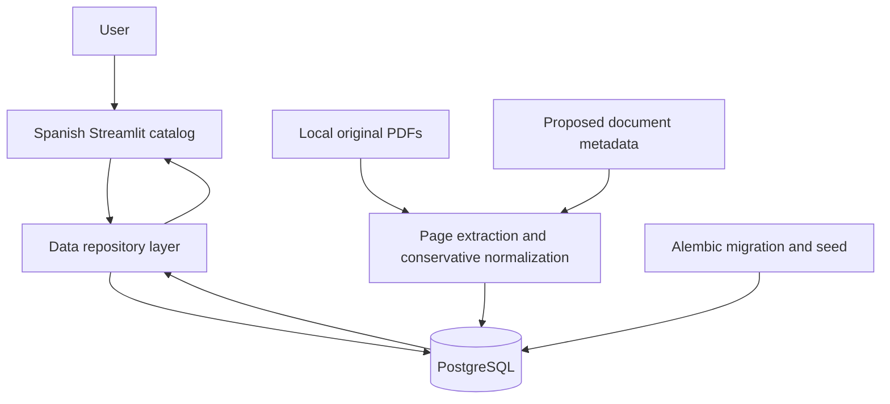

# TechnicalNexus — Advance 1 roadmap

Updated: 2026-10-17. Active consolidated English plan. Earlier Spanish planning
history is retained locally under work/, not as a competing active roadmap.
This is an execution plan and progress record, not the final academic submission.

## 1. Agreed scope and principles

Build an equipment-scoped technical assistant. The first domain is office-printer
maintenance; Brother DCP-T430W is selected. The owner will provide/select two other
models, aiming for different brands, technologies and capacity. Do not invent
those models or block independent work while they are pending. The three-model
Advance 1 cannot be declared complete with only Brother.

The instance defines authorized area, equipment, versions and sources. Unknown
models, another department (e.g. HR), unsupported regulations and missing evidence
must produce clarification, scope limits or escalation. Do not transfer instructions
between printers. An instance is a knowledge boundary, not a server or a user session.
No absolute safety, secrecy, diagnosis or correctness guarantee is claimed.

- Product/repository: TechnicalNexus, https://github.com/Praxisinfinitum/TechnicalNexus,
  private. Local repository is linked; no public publication is authorized.
- English: code, schema, tests, comments, commits and documentation. Preserve original
  source language/titles. GUI and technical answers start in Spanish.
- Stable i18n message IDs and catalogs; adding a language must not duplicate the engine.
  Translated technical knowledge requires review, not automatic approval.
- Local Streamlit, Python 3.12.14, NLTK rules, PostgreSQL 18.3. No Colab/notebook work.
- uv.lock fixes dependencies; validated uv 0.13.1. Use --link-mode=copy on OneDrive.
- PostgreSQL stores metadata, pages and approved knowledge; files/models stay external.
- No embeddings/RAG, image training, Flask, container or cloud deployment in Advance 1.
  Prepare module boundaries and configuration instead of implementing future services.
- Owner personally reviews/understands and submits to Canvas. Do not accept authorship
  declarations or submit on their behalf.

## 2. Academic requirements and provenance

Previously inspected authenticated course pages:
- Advance 1: https://cursos.tecmilenio.mx/courses/254360/assignments/4614153
- Advance 2: https://cursos.tecmilenio.mx/courses/254360/assignments/4614156
- Final: https://cursos.tecmilenio.mx/courses/254360/assignments/4614163

The published Advance 1 originally read mentioned Colab; the owner later clarified
it is a suggestion and explicitly selected local development. Preserve this distinction;
do not claim the page changed. Verify new instructor instructions when available.

| Advance 1 criterion | Points | Required evidence |
|---|---:|---|
| Problem/justification | 20 | Situation, affected users, need, AI justification; objective, target users, scope and expected benefits linked to problem |
| Architecture | 20 | User, chatbot, knowledge base and conversation flow with relationships/exchanges |
| Intents/flows | 20 | Every intent has user need/input, identification and associated response |
| Implementation | 25 | Python 3.10+ and functional NLTK rules chatbot; GitHub evidence; local environment per owner decision |
| Tests/analysis | 15 | At least 10 distinct conversations with inputs/responses; observed functioning, limitation and related improvement |

Week 2, 15% weighting. No official minimum number of intents or report page count
was specified in the inspected Advance 1. The facilitator explicitly requested a
block architecture diagram; include it in the proposal and academic draft.

## 3. Four phases and validation policy

Do not ask approval per function, file or test. Each phase ends with unit tests,
the accumulated regression suite and exactly three brief owner checks, about
5–10 minutes total. Present the owner checks after automated testing, not after
each unit test. Never mark owner acceptance without their response. Independent
reversible next-phase work may proceed while waiting; rejected behavior must be
corrected before building dependent work. Minor improvements go to the backlog.

One full automated command: `.venv/Scripts/python.exe -m pytest -q`.
Tests must assert useful behavior and boundaries, not mirror implementation or
require arbitrary coverage. Avoid literal answer matching except where necessary.
Use real PostgreSQL for persistence regression, not SQLite. Record versions and
actual results; no fabricated executions, metrics or screenshots.

| Phase | Implementation | Automated tests | Owner validation | Evidence / next action |
|---|---|---|---|---|
| 1. Foundation, scope, architecture | Implemented for Brother; models 2/3 deferred | Passed in development and clean environment | Checks 1–2 accepted; check 3 partial | docs/phase1-evidence.md; docs/user-validation.md |
| 2. Rules engine and approved knowledge | Pending | Pending | Pending | Review source applicability and compose approved answers |
| 3. Streamlit conversations | Pending | Pending | Pending | Integrate engine with session state and references |
| 4. Advance 1 validation/package | Pending | Pending | Pending | 10+ conversations, analysis and GitHub evidence |

### Phase 1 — Foundation, reproducible environment and source scope

Implement: inspect instructions/materials; record exact equipment and sources;
prepare configuration, dependency lock, initial PostgreSQL schema/migration/seed,
PDF catalog and conservative extraction; separate engine contract from GUI/data.
Create README and living NotaAcademica.md. Investigate visual-data feasibility
briefly without collecting a complete dataset or training a model. Preserve sources,
register unknown download URLs as unknown, and keep generic model applicability
pending. Initial GUI shows catalog/status only, not simulated maintenance answers.

Automated validation:
- Unit: valid/invalid configuration, normalization preserving warnings/negation,
  conservative classification, language fallback and immutable context selection.
- Regression: allowed equipment, unknown equipment and another instance rejected;
  these are explicit selection tests, not NLP classification.
- PostgreSQL integration: fresh schema migration, idempotent seed/import, page/source
  identity, no automatic approval and catalog isolation. Dedicated *_test database.
- Smoke: Spanish Streamlit catalog and controlled unavailable-DB message.
- Reconstruct a second environment from uv.lock and execute the same full suite.

Owner validation (pending): review Brother/catalog and missing models; read objective/
architecture; open the initial Spanish app and verify its catalog and phase status.
Detailed instructions: docs/user-validation.md.

### Phase 2 — Rules engine and approved knowledge

Implement functional NLTK normalization/rules; intent precedence and all intent flows;
help, selection/change, scoped technical queries, clarification, out-of-scope,
no-evidence and closure. Use explicit request/context -> status/intent/response/
references. Technical answers live in PostgreSQL with model, language, conditions
and source-page references. Review sources before approval. Reset technical context
when switching models. No LLM, web search at response time or unreviewed norms.
Provide a minimal CLI demonstration rather than a second complete UI.

Automated validation:
- Unit: representative intent detection, context switching and correct-source answer.
- Regression: queries for each incorporated model, missing model, unsupported device,
  HR request, absent norm and absent evidence; parameterize cases.
- Persistence: only approved knowledge for confirmed applicability can reach answers;
  repeat imports without duplication and check every technical reference.

Owner checks: (1) one query per incorporated model and one manual comparison;
(2) unrelated/no-evidence query; (3) change equipment and check context/clarification.
Do not claim completion of all three models while the other manuals are pending.

### Phase 3 — Streamlit conversational experience

Implement selector, Spanish conversation history/input, visible references, reset,
per-session state and clear model changes. Handle errors without driver tracebacks,
credentials or invented fallback answers. Keep the motor reusable behind future Flask;
no API/container/tunnel yet. Update implemented architecture in the academic draft.

Automated validation:
- Unit: adapter/error logic where meaningful.
- Regression: motor suite plus a small AppTest selection/send/reset journey.
- Isolation: independent session contexts cannot affect each other.

Owner checks: (1) start from README and complete a referenced query; (2) change model,
reset and compare another session; (3) check ambiguous/out-of-scope recovery wording.

### Phase 4 — Complete Advance 1 validation and review package

Run at least 10 genuinely distinct conversations, several with multiple turns.
Cover all intents, three models when available, ambiguity, missing model, model
switching, unknown model, unrelated area and missing evidence/norm. Record expected
and actual turn results, version, references and observations. Ten messages are
not ten conversations. Reuse regression cases and collect real Streamlit evidence.
Analyze observed behavior, a limitation and a related improvement. Record initial
failures and retests. Recreate environment/schema/data, review links and publish
permitted code/evidence to the private GitHub repository; never upload credentials,
local tools or unreviewed source PDFs. Keep academic draft living, not a fictitious
completed final report. Prepare a short continuation backlog.

Automated validation: full unit/regression/UI/persistence suite; clean installation,
startup and migrations; consistency of referenced evidence/source IDs and paths.

Owner checks: (1) brief valid/change/rejection demo and review conversation summary;
(2) read README and academic draft for accuracy; (3) verify repository/evidence access
and accept or report observations before personally submitting in Canvas.

## 4. Phase-1 implemented block architecture

Diagram is implemented foundation, not the future chatbot. See NotaAcademica.md
for final target flow. Keep Mermaid editable and provide a rendered image when
the final submission viewer cannot render Mermaid. Verify readability before delivery.

## 5. Storage and source policy

Entities: instance, equipment, document/version hash, equipment applicability,
physical page/raw text/normalized text/approval, intent, answer and answer-source.
One file may apply to multiple models; the folder alone never authorizes applicability.
Current initial applicability and extracted pages remain unapproved. Phase 2 must
validate review conditions at the repository query boundary, not only in the GUI.

Original PDF names remain unchanged; metadata provides classification and titles.
Import by SHA-256 is repeatable, changed bytes get another identity. Preserve original
language, edition and source page. Text extraction is not a faithful substitute for
multicolumn/table/diagram layout. Flag empty or defective extraction; full OCR is out
of scope. Do not mix multilingual columns into Spanish technical answers.

PostgreSQL is the only operational database; JSON manifests/fixtures are import data,
not a contradictory second knowledge source. PDFs, images and trained weights remain
external with paths/URIs/hashes. Use explicit instance/equipment/version/approval filters.

Future embeddings attach to stable fragments with text hash, embedding model/version
and dimensions. Do not fix dimensions prematurely. pgvector is currently unavailable
locally; evaluate installation before RAG. RAG can use lexical retrieval and is optional;
vector similarity does not authorize a source or replace classifiers.

Use Alembic migrations and isolated dev/test databases. Never clean development data
in tests. The helper creates a dedicated loopback cluster on 55432 without modifying
existing services. Production requires a restricted role, durable database/asset storage
and backup strategy. Credentials stay ignored. Stop the cluster before relocating
this OneDrive workspace; do not copy a live cluster as a backup.

## 6. Documents and language

- README.md: actual features, limits, startup, configuration, tests, source handling,
  structure and deployment prerequisites. Another developer must be able to reproduce it.
- NotaAcademica.md: living English draft for the instructor/final report; problem,
  objective/users/scope/benefits, implemented architecture, phases actually followed,
  intent flows, evidence, limitations/improvements and rubric mapping. Keep the name.
- This roadmap: direction, decisions, status and next actions, updated each phase.
- docs/: source inventory, actual test evidence and pending owner validation.

Spanish catalogs supply GUI strings. Technical answers store a language code and
references; translations require review. Final rendering must meet academic page
count requirements, not infer pages from Markdown line/word counts.

## 7. Advance 2 and final alignment

Advance 2, week 5 (15%): build intent dataset; tokenization, normalization, stopwords,
lemmatization/stemming; TF-IDF or BoW; Naive Bayes or SVM and evaluation. Visual:
ResNet50 or EfficientNet transfer learning, accuracy/precision/recall/F1/confusion
matrix. Integrate text processing, image classification and communication of results;
analyze both components with evidence-supported limitations and final actions.

Final, week 8 (40%): Streamlit + Flask REST (25 points), NLP chatbot + visual model +
reactive/deliberative/hybrid agent with real information exchange (25), cloud/public
URL with deployment evidence (20), tests and performance/scalability/maintainability/
ethics analysis grounded in results (15), documentation/demo (15).
Eight outputs: 15–20-page technical document, GitHub link, 5–10-minute video, public
URL, final architecture, tests/deployment evidence, classification/chatbot metrics,
and improvement plan. Weeks 6–7 integrate/deploy; week 8 reviews/corrects/delivers.

Chosen later deployment: Streamlit Community Cloud and Cloudflare Tunnel exposing
Flask. The tunnel does not host Flask or PostgreSQL. Choose persistent backend/DB
hosting and validate availability before week 8. No AWS deployment is planned.

Target flow: user text + confirmed device + optional image -> Streamlit -> Flask ->
agent -> NLP/visual classification -> scoped approved knowledge -> referenced response,
clarification or escalation. An image category is not diagnosis or device identification.
Use meaningful classes only after verifying sufficient permitted data. Split by original
sheet/capture group to avoid train/test leakage. Image feasibility is still pending;
MVTec candidates were inspected but not selected for this printer task.

Keep engine contracts, equipment/intent/source IDs and data access independent of UI.
Future inference/API uses those boundaries instead of rewriting the rules knowledge.
Text/image metrics are future work; no model accuracy or measured time benefit exists yet.

## 8. Immediate next action and acceptance

Phase 1 implementation and automated validation are ready for the three owner checks.
Two models, source applicability approval, detailed online user guide and visual dataset
remain pending; none should be fabricated. Next implementation is phase 2 after owner
feedback, maintaining source approval and evidence boundaries. Do not silently begin
all later phases based solely on this plan.
